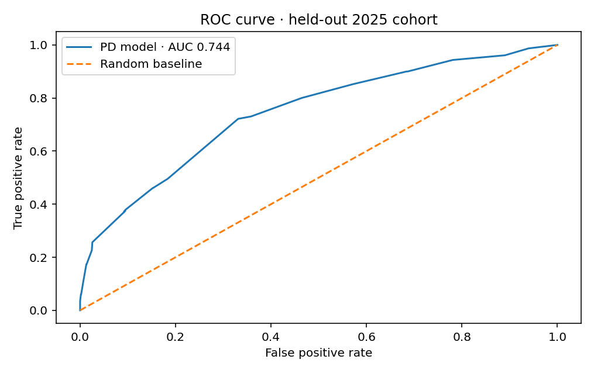
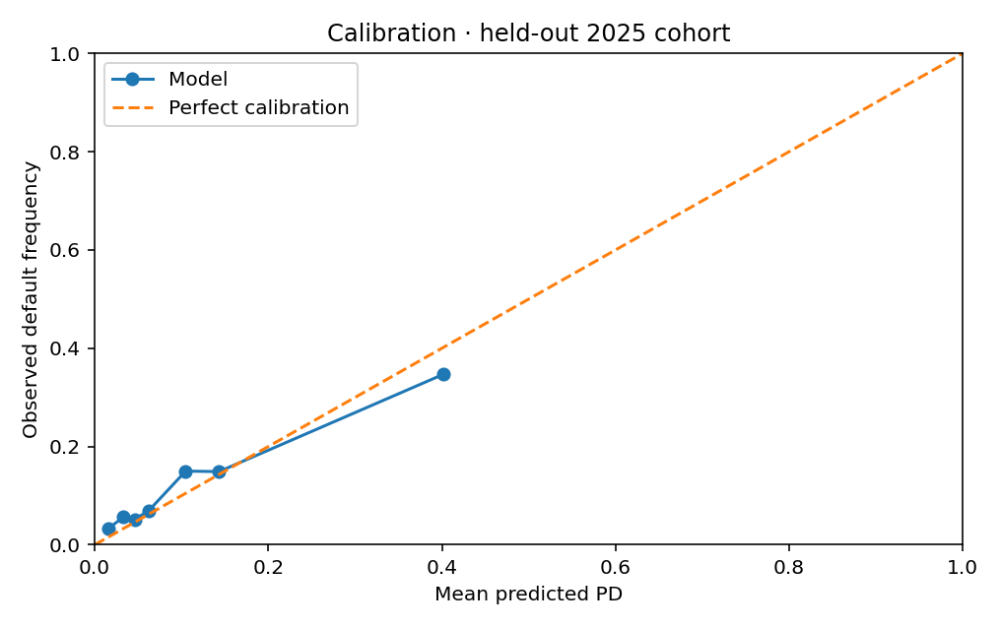
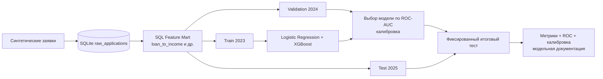

# Credit Risk PD Scoring

**Учебный ML-проект по оценке вероятности дефолта (PD) · Python · SQL · scikit-learn · XGBoost · SciPy**

> **Важно:** проект использует **только синтетические данные** и не является кредитным скорингом банка. Категория `small_business` в примере — условная метка, **не реальные данные ИП/юридических лиц**. Результаты демонстрируют методы и не применимы для принятия решений о кредитовании.

## Зачем нужен проект

В риск-аналитике банка нужно оценивать **PD — вероятность дефолта заёмщика в течение заданного горизонта**. Этот проект показывает базовый воспроизводимый workflow: от данных и SQL-витрины до сравнения ML-моделей, анализа вероятностей и документации модели.

Выполнено:
- генерируются **6 000 вымышленных кредитных заявок** с доходом, отношением долговых платежей к доходу, историей просрочек и другими признаками;
- создаётся SQL-витрина `feature_store_applications` в **SQLite** (демонстрация принципа feature snapshot, **не промышленный Feature Store**);
- считаются признаки `loan_to_income` и `has_delinquency` с контролем количества строк и целевой переменной;
- сравниваются **Logistic Regression и XGBoost** на временном validation;
- оценивается независимый временной test с метриками **ROC-AUC, Gini, PR-AUC, Brier, Log Loss, precision и recall**;
- проверяется **изотоническая калибровка** вероятностей: она не обязана улучшать Brier;
- строятся **ROC-кривая, calibration plot**, сегменты риска и автоматические отчёты;
- применяются методы статистики SciPy (Mann–Whitney U, Spearman) и пример мониторинга PSI;
- есть автоматические тесты и GitHub Actions.

## Результат демонстрации





Для фиксированного `seed=42`, 6000 заявок на локальном тесте:

| Показатель | Значение |
|---|---:|
| Train (заявки 2023) | 2 020 |
| Validation (заявки 2024) | 1 996 |
| Test (заявки 2025) | 1 984 |
| Выбранная по ROC-AUC на validation | Logistic Regression |
| Test ROC-AUC, откалиброванная | **0.744** |
| Test Gini | **0.488** |
| Test Brier, откалиброванная | **0.090** |
| Test Brier, исходная | **0.089** |

**Вывод:** по ROC-AUC на validation в этом запуске победила Logistic Regression. Калибровка на 2024 году **не улучшила** Brier на 2025-м; это корректный результат эксперимента, не ошибка. Подробнее: [`assets/demo_metrics.json`](assets/demo_metrics.json) и [`docs/MODEL_CARD.md`](docs/MODEL_CARD.md). Числа **нельзя** трактовать как качество модели на банковском портфеле.

## Быстрый запуск (Windows PowerShell)

Из корневой папки проекта, нужен Python 3.10+:

```powershell
py -m venv .venv
.\.venv\Scripts\python.exe -m pip install -r requirements-dev.txt
.\.venv\Scripts\python.exe -m pytest -q
.\.venv\Scripts\python.exe -m credit_risk demo
```

Демонстрация создаст:

```text
data/raw/applications.csv        # вымышленные заявки
data/credit_features.sqlite     # таблицы raw_applications + feature_store_applications
reports/metrics.json            # результаты сравнения моделей и оценки на test
reports/eda_statistics.json     # описательные характеристики, корреляции, PSI
reports/test_pd_scores.csv      # test-заявки и прогнозы PD
reports/risk_segments.csv       # условные сегменты риска
reports/roc_curve.png
reports/calibration.png
```

Если установка XGBoost не удалась, можно запустить только Logistic Regression:

```powershell
.\.venv\Scripts\python.exe -m credit_risk demo --no-xgboost
```

Для ускоренного опыта: `python -m credit_risk demo --n 900`. Для повторной оценки уже сохранённого CSV: `python -m credit_risk model --data data/raw/applications.csv`.

**SQL-проверки:** открой `data/credit_features.sqlite` в DB Browser for SQLite или через Python sqlite3; выполни запросы из [`sql/02_quality_checks.sql`](sql/02_quality_checks.sql).

## Архитектура



> Препроцессинг (`SimpleImputer`, `StandardScaler`, `OneHotEncoder`) обучается **только** на train внутри `Pipeline`, не на test. Временное разделение снижает риск утечки информации. Метка `default_12m` нужна для supervised-обучения, но исключена из признаков.

## Структура

```text
credit_risk/
  generate.py       генерация синтетических заявок
  mart.py           запись и контроль SQL-витрины
  model.py          pipeline, split, Logistic Regression, XGBoost, метрики, калибровка
  statistics.py     Mann–Whitney U, Spearman, PSI
  report.py         таблицы, JSON, ROC и calibration
  __main__.py       CLI
docs/
  BUSINESS_CASE.md
  MODEL_CARD.md
  DATA_DICTIONARY.md
  INTERVIEW_QA.md
  RESUME_DESCRIPTION.md
sql/
  01_feature_mart.sql
  02_quality_checks.sql
tests/test_pipeline.py
assets/             воспроизводимые иллюстрации и демонстрационные метрики
.github/workflows/tests.yml
```

## Что важно для риск-аналитики

- **ROC-AUC/Gini** — ранжирующая способность модели; не говорят, хорошо ли откалиброваны PD.
- **Brier/Log Loss** — качество вероятностных прогнозов; калибровку нужно проверять на независимом периоде.
- **PR-AUC** — полезна при редких дефолтах; оценивать в контексте базовой частоты класса.
- **PSI** — вспомогательная эвристика дрейфа распределения; пороги нельзя считать универсальными.
- **Feature Store** — признак должен быть известен на дату оценки; поздние события и целевой `default_12m` не могут попадать в признаки.
- **Риск решений** — в реальных кредитных моделях требуются тесты стабильности, юридические ограничения, fairness и мониторинг дрейфа; здесь этого нет.

## Ограничения и честность результата

Использована **синтетическая генеративная формула**, поэтому модель может угадывать построенную автором закономерность. В проекте **нет реальных данных о заемщиках**, нет промышленного Feature Store и нет модели конкретного банковского продукта. Разделение train/validation/test и проверка на 2025 году демонстрируют метод, но не доказательство пригодности для банка. После добавления реального открытого набора нужна отдельная постановка, проверка лицензии, даты доступности признаков и возможных утечек.

Портфолио-проект создан для обучения и технического собеседования; без персональных данных и реальных кредитных решений.
